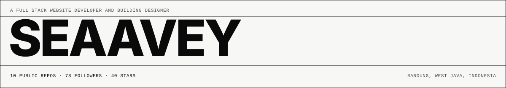

<picture>
  <source media="(prefers-color-scheme: dark)" srcset="./profile/banner-dark.svg" />
  
</picture>

I build web interfaces and the infrastructure behind them. Most of it is Rust, Go and TypeScript: self-hosted LLM gateways, terminal agents, and front ends built on strict typographic grids. Based in Bandung, West Java, Indonesia.

[GitHub](https://github.com/seaavey) · [seaavey.com](https://www.seaavey.com) · [dotfiles](https://github.com/seaavey/dotfiles) · [owner@seaavey.com](mailto:owner@seaavey.com)

## Repositories

<!-- AUTO:REPOS: generated from the GitHub API by scripts/profile.mjs -->
| REPOSITORY                                            | LANGUAGE   | STARS | FORKS | LAST PUSH  |
| :---------------------------------------------------- | :--------- | :---- | :---- | :--------- |
| [SRouter](https://github.com/seaavey/SRouter)         | Rust       | 24    | 13    | 2026-10-27 |
| [seaavey-bot](https://github.com/seaavey/seaavey-bot) | TypeScript | 10    | 3     | 2026-07-18 |
| [finance](https://github.com/seaavey/finance)         | Vue        | 5     | 1     | 2026-06-20 |
| [Seavx](https://github.com/seaavey/Seavx)             | Rust       | 1     | 1     | 2026-10-28 |
| [SeavxBot](https://github.com/seaavey/SeavxBot)       | TypeScript | 0     | 1     | 2026-10-25 |
| [dotfiles](https://github.com/seaavey/dotfiles)       | Shell      | 0     | 0     | 2026-10-14 |
| [smcp](https://github.com/seaavey/smcp)               | Rust       | 0     | 0     | 2026-09-14 |
<!-- /AUTO:REPOS -->

## Setup

Arch Linux with the Hyprland compositor, Kitty as the terminal, Zed to edit, Zsh for scripting.

| COMPONENT      | VALUE                                                   |
| :------------- | :------------------------------------------------------ |
| OS             | Arch Linux x86_64                                       |
| Window manager | Hyprland (Wayland)                                      |
| Terminal       | Kitty                                                   |
| Editor         | Zed                                                     |
| Shell          | Zsh                                                     |
| Config         | [seaavey/dotfiles](https://github.com/seaavey/dotfiles) |

## Activity

  
  
    
  
    
  

## Contact

- [owner@seaavey.com](mailto:owner@seaavey.com)
- [github.com/seaavey](https://github.com/seaavey)
- [seaavey.com](https://www.seaavey.com)
- [github.com/seaavey/dotfiles](https://github.com/seaavey/dotfiles)
